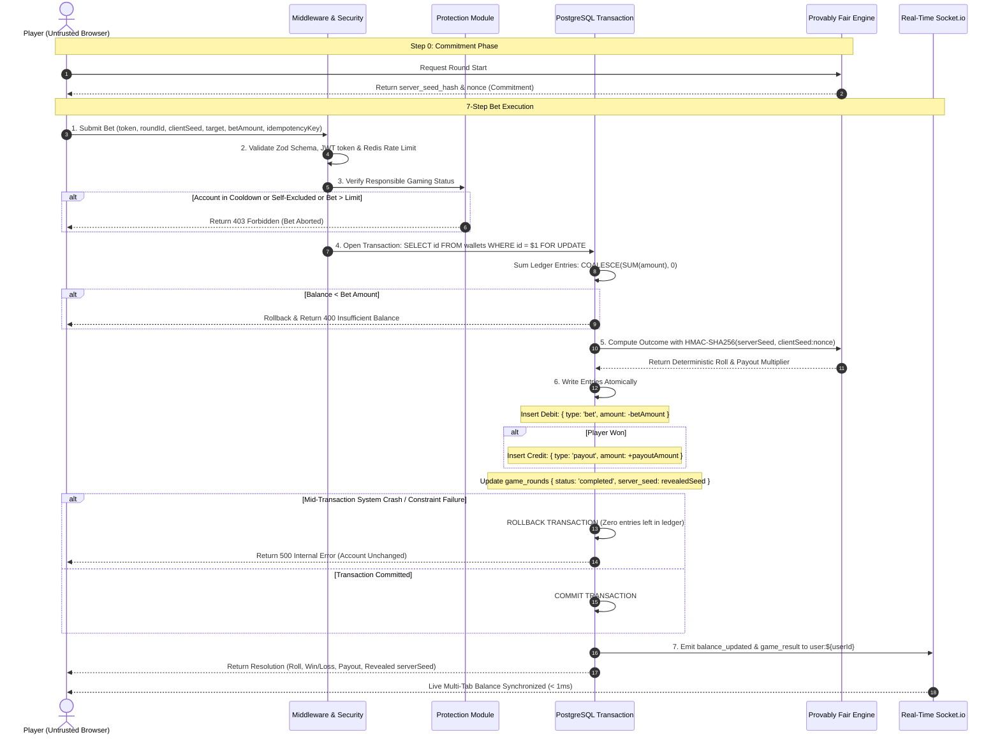

# The Seven-Step Bet Execution Flow (With Atomic Rollback)

Every game round executes through a strict 7-step transaction pipeline ensuring cryptographic fairness, responsible gaming enforcement, and ACID ledger consistency.

