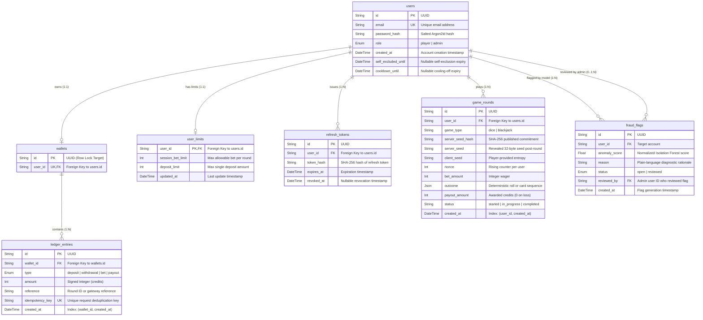

# Seven-Table Database ER Diagram

The database uses integer credits (no floats) for all transaction amounts. Wallets contain no mutable balance field — balance is dynamically computed as `COALESCE(SUM(amount), 0)` over `ledger_entries`.

